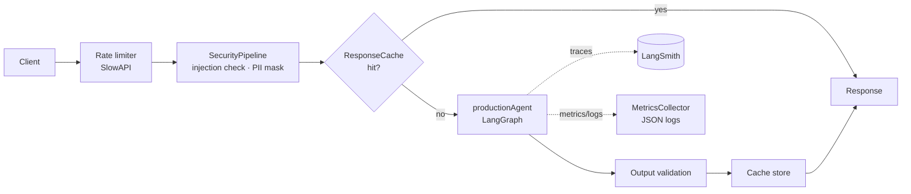
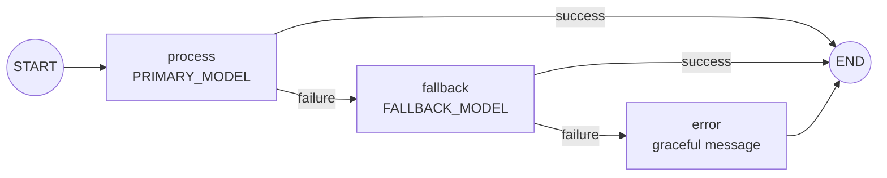

# RAG Engineering Lab

A hands-on LangChain / LangGraph lab: step-by-step lessons for building
Retrieval-Augmented Generation (RAG) systems, and a production-style FastAPI
service that puts the patterns together (model fallback, caching, security,
structured logging, metrics and LangSmith tracing).

The default LLM provider is **Google Gemini**, on the low-cost **"lite"** model tier.

---

## Contents

- [Tech stack](#tech-stack)
- [Repository structure](#repository-structure)
- [Quick start](#quick-start)
- [Configuration](#configuration)
- [Lessons (`src/lang_course/`)](#lessons-srclang_course)
- [Production API (`src/lang_course/project/`)](#production-api-srclang_courseproject)
- [Testing](#testing)
- [Model and cost policy](#model-and-cost-policy)
- [Security notes](#security-notes)
- [Known issues and roadmap](#known-issues-and-roadmap)
- [Adding a new lesson](#adding-a-new-lesson)

---

## Tech stack

| Area            | Tools                                                                 |
|-----------------|-----------------------------------------------------------------------|
| Language        | Python 3.12, managed with [uv](https://docs.astral.sh/uv/)            |
| LLM framework   | LangChain 1.x, LangGraph, LangChain Classic / Community / Experimental |
| Models          | Google Gemini (`langchain-google-genai`); OpenAI / OpenRouter optional |
| Vector stores   | Chroma, FAISS, PostgreSQL pgvector (Supabase)                         |
| Retrieval       | Dense vectors, BM25 (`rank-bm25`), hybrid / ensemble retrievers       |
| API             | FastAPI, Uvicorn, SlowAPI (rate limiting), Pydantic Settings          |
| Observability   | LangSmith tracing, JSON structured logs, in-process metrics           |
| Testing         | pytest, unittest                                                      |

---

## Repository structure

```
Lang-course/
├── Docs/
│   └── RAG.pdf                     Sample PDF used by the document-loader lesson
├── src/lang_course/                Lesson package (run with `python -m lang_course.<folder>.<file>`)
│   ├── __init__.py
│   ├── common/
│   │   └── llm.py                  Shared get_model() / get_embeddings() helpers (read MODEL / EMBEDDING_MODEL)
│   ├── setup_check/
│   │   └── check_models.py         Verifies your API keys and model access
│   ├── document_loaders/
│   │   └── loaders.py              Load text files and PDFs into LangChain Documents
│   ├── debug/
│   │   └── text_spliters.py        Text splitters, chunk size and chunk overlap
│   ├── chunking/
│   │   ├── semantic_chunking.py    Embedding-based semantic chunking
│   │   └── advanced_rag.py         Multi-query, contextual compression, ensemble, parent-document retrieval
│   ├── embeddings/
│   │   └── embedding.py            Embedding basics, batching, cosine similarity
│   ├── caching/
│   │   └── embeddings.py           Gemini embeddings + cache-backed embeddings
│   ├── vector_db/
│   │   └── app.py                  Chroma and FAISS: similarity scores, metadata filtering
│   ├── pipeline/
│   │   └── rag.py                  End-to-end RAG chain, with and without source citations
│   ├── hybrid_search/
│   │   ├── hybrid_search.py        BM25 + vector ensemble retrieval
│   │   ├── final_prod.py           Production-style HybridRetriever class
│   │   └── cost_optimizing.py      Model routing, semantic caching, token budgets
│   ├── langsmith/
│   │   └── langsmith_setup.py      LangSmith tracing, named runs, trace metadata
│   ├── logs/
│   │   └── monitoring.py           JSON logging, metrics, instrumented Gemini chat + embeddings
│   ├── supabase/
│   │   ├── supabase_connection.py  Connect to Supabase Postgres + pgvector
│   │   └── production_example.py   RAGService on pgvector with Gemini
│   └── project/                    Production FastAPI service (its own uv project, see below)
│       ├── app/
│       │   ├── main.py             FastAPI app + lifespan (startup / shutdown)
│       │   ├── config.py           Pydantic Settings, loaded from .env
│       │   ├── agent.py            LangGraph agent: primary → fallback → graceful error
│       │   ├── cache.py            TTL response cache (SHA-256 keys)
│       │   ├── security.py         Prompt-injection, PII masking, output validation
│       │   ├── monitoring.py       JSON logger + MetricsCollector
│       │   └── models.py           Request / response schemas
│       ├── tests/                  pytest suite + manual demos
│       ├── .env.example            Template for the service's .env
│       ├── pyproject.toml          Service dependencies
│       └── uv.lock
├── .vscode/settings.json           Lets Pylance resolve the service's `app.*` imports
├── .env.example                    Template for the lessons' .env
├── pyproject.toml                  Lesson dependencies
└── uv.lock
```

The repo contains **two separate uv projects**, each with its own virtual environment and `.env`:

| Project      | Root                        | `.env` location                 | Used for              |
|--------------|-----------------------------|---------------------------------|-----------------------|
| Lessons      | `Lang-course/`              | `Lang-course/.env`              | Everything in `src/lang_course/*` except `project/` |
| Production API | `src/lang_course/project/` | `src/lang_course/project/.env` | The FastAPI service   |

---

## Quick start

**Prerequisites:** Python 3.12, [uv](https://docs.astral.sh/uv/getting-started/installation/), and a
Google AI Studio (Gemini) API key.

```bash
git clone https://github.com/som0121/RAG-engineering-lab.git
cd RAG-engineering-lab

# 1. Lessons
uv sync
cp .env.example .env                        # Windows: copy .env.example .env
#   → set GOOGLE_API_KEY in .env
uv run python -m lang_course.setup_check.check_models

# 2. Production API
cd src/lang_course/project
uv sync
cp .env.example .env                        # Windows: copy .env.example .env
#   → set GOOGLE_API_KEY in .env
uv run pytest
uv run uvicorn app.main:app --reload        # serves on http://127.0.0.1:8000
```

Always run code through `uv run`. Plain `python` uses your system interpreter, which
doesn't have the project's packages.

---

## Configuration

Both `.env` files are gitignored. Never commit real keys; only the `.env.example` templates are tracked.

### Lessons: `Lang-course/.env`

| Variable                | Required | Default / example                    | Purpose                                             |
|-------------------------|----------|--------------------------------------|-----------------------------------------------------|
| `GOOGLE_API_KEY`        | yes      | —                                    | Gemini chat and embedding models                    |
| `MODEL`                 | yes      | `google_genai:gemini-3.5-flash-lite` | Chat model for `common/llm.py`, as `provider:model` |
| `EMBEDDING_MODEL`       | yes      | `google_genai:gemini-embedding-001`  | Embedding model for `common/llm.py`                 |
| `LANGSMITH_TRACING`     | no       | `false`                              | Turn on LangSmith tracing                           |
| `LANGSMITH_API_KEY`     | no       | —                                    | LangSmith key                                       |
| `LANGSMITH_PROJECT`     | no       | `lang-course`                        | LangSmith project name                              |
| `USER_AGENT`            | no       | `lang-course/0.1`                    | Sent by `WebBaseLoader`                             |
| `SUPABASE_DATABASE_URL` | for `supabase/` | `postgresql+psycopg://…`      | Supabase Postgres connection string                 |

`common/llm.py` also supports `openrouter:<model>` names (these need `OPENROUTER_API_KEY`), and any
other `init_chat_model` provider whose key you set.

### Production API: `src/lang_course/project/.env`

| Variable             | Required | Default                          | Purpose                                     |
|----------------------|----------|----------------------------------|---------------------------------------------|
| `GOOGLE_API_KEY`     | yes      | —                                | Gemini key (validated at startup)           |
| `PRIMARY_MODEL`      | no       | `gemini-3.5-flash-lite`          | First model the agent tries                 |
| `FALLBACK_MODEL`     | no       | `gemini-3.1-flash-lite`          | Used if the primary model fails             |
| `LANGSMITH_TRACING`  | no       | `true`                           | LangSmith tracing                           |
| `LANGSMITH_API_KEY`  | no       | —                                | LangSmith key                               |
| `LANGSMITH_PROJECT`  | no       | `production-api`                 | LangSmith project                           |
| `LANGSMITH_ENDPOINT` | no       | `https://api.smith.langchain.com`| LangSmith endpoint                          |
| `APP_ENV`            | no       | `development`                    | `production` enables `Settings.is_production` |
| `LOG_LEVEL`          | no       | `INFO`                           | Log level                                   |
| `RATE_LIMIT`         | no       | `20/minute`                      | SlowAPI rate limit                          |
| `CACHE_TTL_SECONDS`  | no       | `300`                            | Response cache TTL                          |
| `MAX_RETRIES`        | no       | `3`                              | Agent retry budget                          |

---

## Lessons (`src/lang_course/`)

Run each lesson from the repo root:

```bash
uv run python -m lang_course.<folder>.<file>      # e.g. lang_course.pipeline.rag
```

| # | Module | What it covers | Provider |
|---|--------|----------------|----------|
| 1 | `setup_check.check_models` | Checks that your keys and models respond | `MODEL` (+ optional OpenAI / Anthropic) |
| 2 | `document_loaders.loaders` | `TextLoader`, `PyPDFLoader` on `Docs/RAG.pdf` | — |
| 3 | `debug.text_spliters` | Recursive splitting, chunk size, why overlap matters | — |
| 4 | `embeddings.embedding` | Single and batch embeddings, cosine similarity | OpenAI |
| 5 | `caching.embeddings` | Gemini embeddings, similarity search, `CacheBackedEmbeddings` | Gemini |
| 6 | `vector_db.app` | Chroma and FAISS, scored search, metadata filters | `EMBEDDING_MODEL` |
| 7 | `chunking.semantic_chunking` | `SemanticChunker` compared with fixed-size chunks | OpenAI |
| 8 | `pipeline.rag` | Full RAG chain (LCEL), answers with source citations | `MODEL` + `EMBEDDING_MODEL` |
| 9 | `chunking.advanced_rag` | Multi-query, contextual compression, ensemble, parent-document retrievers | OpenAI |
| 10 | `hybrid_search.hybrid_search` | BM25 + vector `EnsembleRetriever` | OpenAI |
| 11 | `hybrid_search.final_prod` | Reusable `HybridRetriever` class | OpenAI |
| 12 | `hybrid_search.cost_optimizing` | Model routing, semantic cache, token budgets | OpenAI |
| 13 | `langsmith.langsmith_setup` | Tracing, named runs, metadata and tags | OpenAI |
| 14 | `logs.monitoring` | JSON logs, metrics, an instrumented LLM wrapper | Gemini |
| 15 | `supabase.supabase_connection` | Connect to Supabase and check pgvector | Gemini embeddings |
| 16 | `supabase.production_example` | `RAGService`: ingest, retrieve with a score threshold, answer | Gemini |

Lessons marked **OpenAI** hard-code `ChatOpenAI` / `OpenAIEmbeddings` and need an `OPENAI_API_KEY`
with credit. See [Known issues](#known-issues-and-roadmap).

---

## Production API (`src/lang_course/project/`)

A FastAPI service that wraps a LangGraph agent with the reliability, security and
observability layers a production LLM endpoint needs.

### Request flow



### Agent graph (`app/agent.py`)



`productionAgent.invoke(message)` returns
`{"response": str, "model_used": "primary" | "fallback" | "error_handler", "error": str | None}`.
The response is always plain text: `.text` flattens Gemini's content blocks into a string.

### Components

| Module | Responsibility |
|--------|----------------|
| `main.py` | Creates the `FastAPI` app. `lifespan()` builds the shared components on startup and logs a metrics summary on shutdown. |
| `config.py` | `Settings` (pydantic-settings) reads `.env`. Cached by `get_settings()`. |
| `agent.py` | LangGraph state machine with `ChatGoogleGenerativeAI` primary and fallback models, traced with `@traceable`. |
| `cache.py` | `ResponseCache`: in-memory TTL cache keyed by the SHA-256 of the normalized query, with hit/miss stats. |
| `security.py` | `InputSanitizer` (prompt-injection patterns), `PIIDetector` (email, phone, SSN, card, IP masking), `OutputValidator` (blocks leaked secrets / harmful text), combined in `SecurityPipeline`. |
| `monitoring.py` | `JSONFormatter`, `get_logger()`, `MetricsCollector` (requests, errors, latency, tokens, cache hit rate). |
| `models.py` | `ChatRequest`, `ChatResponse`, `HealthResponse`, `MetricsResponse`, `ErrorResponse`. |

### Running

```bash
cd src/lang_course/project
uv run uvicorn app.main:app --reload            # dev
uv run uvicorn app.main:app --host 0.0.0.0 --port 8000 --workers 2   # prod-style
```

Startup logs are JSON, for example:

```json
{"level": "INFO", "message": "Starting production API...", "environment": "development", "primary_model": "gemini-3.5-flash-lite", "tracing_enabled": true}
```

> **Note:** the HTTP routes (`POST /chat`, `GET /health`, `GET /metrics`) are not written yet.
> The components and schemas they'll use are in place. See the [roadmap](#known-issues-and-roadmap).

---

## Testing

```bash
cd src/lang_course/project
uv run pytest -q                 # 18 tests: 4 agent + 14 security
uv run python -m tests.test_cache   # manual cache walkthrough
```

| File | Type | Covers |
|------|------|--------|
| `tests/test_agent.py` | pytest (4) | Primary success, fallback on failure, both models failing, message passing (models mocked, no API calls) |
| `tests/test_security.py` | pytest (14) | Injection detection, PII detection and masking, output validation, full pipeline |
| `tests/test_cache.py` | manual script | Cache miss, hit, TTL expiry, stats |
| `tests/demo_monitoring.py` | manual script | Logger and metrics output |
| `tests/langsmith_connection.py` | manual script | Checks that LangSmith tracing works: `uv run python tests/langsmith_connection.py` |

The agent tests mock the LLMs, so they run offline and need no API key.

---

## Model and cost policy

- **Gemini only, lite tier.** Chat uses `gemini-3.5-flash-lite`, with `gemini-3.1-flash-lite` as the fallback.
  Embeddings use `gemini-embedding-001`.
- One provider key per environment (`GOOGLE_API_KEY`). There are no OpenAI, OpenRouter or Anthropic keys in the default setup.
- To change models, edit `PRIMARY_MODEL` / `FALLBACK_MODEL` or `MODEL` in the relevant `.env`, not the code.
- Changing the **embedding** model makes existing vectors (for example in Supabase) incompatible. Re-ingest after any change.

---

## Security notes

- `.env` files are gitignored. Commit only `.env.example` with placeholder values.
- If a key is ever pasted somewhere public (a chat, an issue, a log), revoke it and generate a new one.
- `SecurityPipeline` is built so that input is checked and sanitized before it reaches the model, and output is validated before it's returned. It's created at startup; the routes that will call it are still on the roadmap.
- PII (email, phone, SSN, card number, IP address) is masked before text reaches the model.

---

## Known issues and roadmap

- [ ] **API routes**: add `POST /chat`, `GET /health`, `GET /metrics`, connect SlowAPI, and fill in `tests/test_api.py`.
- [x] **`app/models.py`**: `ChatResponse.timestamp` is now an ISO-8601 UTC string (`timezone` was missing from the imports).
- [x] **`supabase/` lessons**: `langchain-postgres` added to `pyproject.toml`.
- [ ] **OpenAI-based lessons** (4, 7, 9–13): switch to `common.llm.get_model()` / `get_embeddings()` so they follow the Gemini `.env` settings.
- [ ] `src/lang_course/project/main.py` is an empty placeholder.

---

## Adding a new lesson

1. Create a folder under `src/lang_course/` with a `.py` file in it.
2. Use the shared helpers so the lesson follows `.env`:
   ```python
   from lang_course.common.llm import get_model, get_embeddings
   llm = get_model()            # uses MODEL
   embeddings = get_embeddings()  # uses EMBEDDING_MODEL
   ```
3. Put the demo code behind `if __name__ == "__main__":` and run it with
   `uv run python -m lang_course.<folder>.<file>`.
4. Add a row to the [Lessons](#lessons-srclang_course) table.

---

**Author:** Som Sundar Parashar
